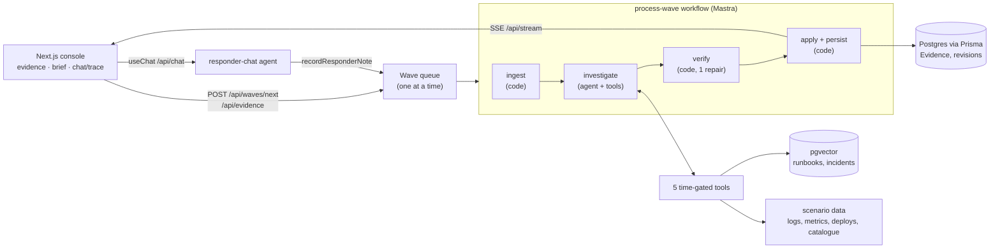

# AIIS: Agentic Incident Investigation System

The first version of an internal AI SRE tool. It replays a messy incident as Waves of Evidence: alerts, Slack chatter, logs, metrics, deploy notes, runbooks and prior incidents. After each Wave an investigator agent pulls more data with tools, separates Signal from Noise, revises its Hypotheses, and keeps a live, cited brief for the incident channel. The brief covers the summary, impact, timeline, ranked Hypotheses with supporting and contradicting Evidence, open questions, next actions, and a stakeholder update.

Domain terms (Incident, Investigation, Wave, Evidence, Signal, Noise, Hypothesis, Responder Note) are defined in [GLOSSARY.md](GLOSSARY.md). The two load-bearing decisions are in [docs/adr](docs/adr). A full investigation of the scenario is in [docs/sample-output.md](docs/sample-output.md).

## Run it locally

You need Node 22.18+, pnpm, Docker, and an [OpenRouter](https://openrouter.ai) API key. OpenRouter serves both the chat model and the embeddings.

```bash
pnpm install
cp .env.example .env        # then set OPENROUTER_API_KEY
pnpm db:up                  # Postgres 17 + pgvector on localhost:5433
pnpm db:migrate             # Prisma tables for Evidence and revisions
pnpm seed                   # embed runbooks and prior incidents into pgvector
pnpm dev                    # http://localhost:3000
```

In the UI, press **Next wave** to step through the incident, or **Play all** to run all five Waves. **Export** downloads the Investigation as Markdown and **Reset** starts again.

Things to try:

- **Citation chips.** Click any chip to see the raw Evidence and its Signal/Noise history.
- **The agent trace tab.** Watch the tool calls stream in while a Wave runs.
- **A false claim in chat.** After Wave 1, tell the chat "the reporting job has been paused by Data Platform". It becomes a Responder Note and starts a Wave. Then press **Next wave**: the investigator checks the claim against telemetry, sees the 10:10 run start anyway, and records that the pause didn't take effect.

Other commands:

```bash
pnpm test        # Vitest: verifier, delta application, time-gated tools, dataset invariants
pnpm eval        # headless replay of all 5 Waves with assertions; rewrites docs/sample-output.md
pnpm eval 2      # replay only the first 2 Waves
pnpm typecheck
pnpm check       # oxlint + oxfmt
```

`pnpm eval` and the UI share the database, so stop one before running the other.

## The scenario

At 10:02 UTC on 13 October, checkout starts failing intermittently. The obvious suspect is the `checkout-api` 2.14.0 deploy at 09:40, which bumped `node-postgres`. An on-call engineer calls it out in chat and rolls it back. That deploy is a red herring.

The real cause is a `reporting-worker` change shipped through Airflow, not the normal argo-cd pipeline. It moved a daily export to every 5 minutes, and a config tidy-up pointed it at the `orders-db` primary instead of the replica. Each run grabs 16 connections, so the primary sits at its 100-connection ceiling in a 5-minute sawtooth, and every service on that database suffers.

| Wave | Clock | What arrives                                                                           |
| ---- | ----- | -------------------------------------------------------------------------------------- |
| 1    | 10:02 | Checkout latency and 5xx alerts; a flapping logging-host disk alert (Noise)            |
| 2    | 10:07 | Support escalation; an engineer blames the deploy; the incident commander acknowledges |
| 3    | 10:12 | orders-db connection alert; inventory errors; a bot-driven 404 alert (Noise)           |
| 4    | 10:18 | A Data Platform announcement from 09:57, reshared late; a VPN chat thread (Noise)      |
| 5    | 10:25 | Rollback finished at 10:20 with no improvement; impact update; latency still periodic  |

Waves push headline Evidence only. The rest (about 54 log lines, 6 metric series, deploy history, the service catalogue, 3 runbooks and 3 prior incidents) is there to be pulled by the agent's tools. Tools are time-gated to the replay clock, so the agent cannot see the future.

## What I built

- **A Mastra workflow that runs once per Wave**: ingest → investigate → verify → apply.
- **One investigator agent with five tools**: `queryLogs`, `getMetrics`, `listDeploys`, `getServiceContext` (the service catalogue and dependency graph), and `searchKnowledge` (vector search over runbooks and prior incidents).
- **A deterministic verifier** that checks every citation before anything reaches the brief.
- **Typed state with revision history** in Postgres, one revision per Wave, so the UI can show what changed, confidence trajectories, and reclassifications.
- **A three-pane console**:
  - Evidence feed with Signal/Noise badges and reclassification history.
  - The brief, where every claim carries citation chips that open the underlying Evidence.
  - A chat assistant and a live agent trace streamed over SSE.
- **A responder chat** that answers from the current Investigation. When a responder states a fact ("the job has been paused"), the chat records it as a Responder Note, which starts a new Wave. You can also paste raw evidence directly.
- **A scenario eval** that replays the incident headlessly and asserts the outcome, plus Markdown export.

## Architecture



- **Next.js 16 App Router**, with Mastra embedded in route handlers. There is no separate agent server, so `pnpm dev` is the whole app. Waves run in the background after the response is sent (Next's `after()`), and progress streams to the browser over Server-Sent Events.
- **Postgres + pgvector** in one Docker container:
  - Prisma owns the domain tables: `Evidence`, and `InvestigationRevision` with the delta, full state, rejected claims and trace.
  - Mastra's own storage (chat memory, workflow snapshots) and the vector index live in a separate `mastra` schema, so they don't fight Prisma's migrations.
- **OpenRouter** serves Claude Sonnet 5.5 for both agents, and `text-embedding-3-small` for retrieval. The model is set by environment variables.

## How the agentic flow works

For each Wave:

1. **Ingest (code).** New Evidence is stamped with its Wave number and added to the Investigation, and the replay clock advances.
2. **Investigate (agent).** The investigator gets the current Investigation and the new Evidence. It has up to about 10 rounds of tool calls, often run in parallel. It typically lists recent deploys, reads logs and metrics for the failing service and its shared dependencies, checks the catalogue for who else uses that database, and searches runbooks and past incidents. It finishes by calling `submitInvestigationUpdate` with a **delta**: only what changed (classify Evidence, open or revise Hypotheses, add or resolve questions, add or replace actions, refresh the summary and stakeholder update).
3. **Verify (code).** Every cited ID must be on the Investigation or have been returned by a tool in this run, and must be observed at or before the replay clock. The verifier then cleans up the delta:
   - Invalid citations are stripped.
   - A claim left with no citations is dropped.
   - A Hypothesis marked supported with no supporting Evidence, or refuted with no contradicting Evidence, is downgraded to open.
   - New Evidence left unclassified is flagged.

   If anything was rejected, the agent gets one repair attempt with the list of issues. Whatever still fails is dropped and shown under "Verifier flags".

4. **Apply (code).** The delta is applied to produce the next state. Retrieved records that the agent cited are promoted to Evidence. A classification is recorded only when it changes, so reclassification is visible. Each Hypothesis keeps a per-Wave history of status and confidence. One revision row stores the delta, full state, rejected claims and agent trace.

The model owns judgement. Code owns anything that must be correct: ordering, time-gating, citation validity, and how state changes. Because of that split, no claim in the brief can cite Evidence that doesn't exist or hasn't happened yet.

**Responder chat** is a second, lighter agent. It sees the current Investigation in its instructions and can use the same read-only tools. It cites Evidence as `[id]`, which the UI renders as chips. It cannot edit the Investigation. If the responder says something factual, it calls `recordResponderNote`. That queues a Wave, and the investigator weighs the note like any other Evidence. This keeps a single path for changing state ([ADR 0001](docs/adr/0001-investigation-changes-by-typed-deltas.md)).

## Memory and state

- **Investigation state** is a typed object (`src/investigation/state.ts`). It changes only by applying a validated delta, one revision per Wave. Earlier reasoning is never regenerated away. The brief shows "what changed in this Wave", Hypothesis confidence trajectories (W1…W5), and Evidence reclassified from Noise to Signal or back.
- **Within a Wave**, the agent's working memory is the current state rendered into the prompt, plus its tool results. That's all it needs: the state is the memory, and it is small.
- **Chat memory** is a Mastra Memory thread in Postgres (last 20 messages). It is cleared on reset.
- **Waves are serialised** through an in-process queue, so a Responder Note sent mid-Wave waits its turn instead of racing.

## Retrieval and tools

- **Vector search (RAG).** Runbooks and prior incident write-ups are embedded into pgvector, one vector per document (`pnpm seed`). `searchKnowledge` returns the closest matches, and the agent is told to treat prior incidents as analogies to compare, not answers. The set is deliberately confusable: INC-2041 is a bad-deploy lookalike, and INC-1987 is pool exhaustion where a rollback didn't help. If embedding fails, the tool falls back to keyword search and tells the agent it is degraded.
- **Service catalogue as a small knowledge graph.** `getServiceContext` returns a service's dependencies, its dependents, its owners, how it is deployed, and its constraints. This is how the agent learns that inventory-service also uses orders-db, and that reporting-worker is supposed to read from the replica and is deployed through Airflow.
- **Telemetry tools.** `queryLogs`, `getMetrics` and `listDeploys` are pure functions over the scenario data, filtered to the replay clock. Logs are truncated to the most recent 25 matches. Deploy history only covers argo-cd, like a real one, so the change that caused the incident isn't there.
- **Every tool call** is recorded in the agent trace, with its input, a summary of the result, and timing.

## Evaluation

`pnpm eval` replays all five Waves and asserts:

- the top Hypothesis is supported and is about reporting-worker exhausting orders-db connections, with matching citations;
- the checkout deploy Hypothesis ends refuted or at low confidence;
- the flapping disk alert is classified as Noise;
- a next action targets the reporting-worker.

It prints the ranked Hypotheses after every Wave and writes [docs/sample-output.md](docs/sample-output.md).

In the committed run:

- **The real cause** is open at medium confidence in Wave 1. It becomes supported at high in Wave 2, once pgwatch attributes 32 connections to the reporting-worker.
- **The deploy** stays open at low until Wave 5. There the failed rollback directly contradicts it, and it is refuted.

An earlier prompt passed the same assertions but rated the cause "high" and refuted the deploy in Wave 1, from telemetry alone and on timing. The eval prints the trajectory as well as the final answer, which is what made that overconfidence visible. Two rules fixed it: "high needs independent kinds of source", and "timing alone does not refute". Unit tests cover the verifier, delta application, the time-gated tools, and dataset invariants. For example, no Evidence in a Wave is observed after the Wave's clock; that test caught two real bugs in the dataset.

## Tradeoffs

- **Final-answer tool instead of structured output.** The delta schema was too large for Anthropic's constrained-decoding grammar, and prompt-injected JSON made the model try to call schema fields as tools. The delta is now the input of a `submitInvestigationUpdate` tool, which ends the run, and the last steps force that tool call. It is reliable, and the schema still validates every field.
- **One investigator, not a supervisor with specialists** ([ADR 0002](docs/adr/0002-hybrid-workflow-single-investigator.md)). At this data size, splitting by source adds handoffs and latency without better reasoning, and weighing evidence across sources is the core of the job.
- **Deltas instead of regenerating the brief** ([ADR 0001](docs/adr/0001-investigation-changes-by-typed-deltas.md)). This costs a bigger schema and a deterministic apply step. In return you get inspectable memory, trajectories, and a brief that doesn't drift between Waves.
- **Scripted replay instead of live integrations.** It is deterministic, repeatable, testable, and cheap to iterate on. The tool interfaces are shaped like real ones (Loki-style log queries, Prometheus-style series, argo-cd history), so they could be swapped for real ones.
- **Categorical confidence (low/medium/high)** instead of percentages, which a model can't calibrate meaningfully. The prompt ties "high" to agreement between independent kinds of source.
- **One vector per document.** The documents are short. Chunking would matter with a real runbook corpus.
- **In-process event bus and Wave queue.** These are fine for a single Node process, but they would need Redis or Postgres `LISTEN/NOTIFY` and a job queue to scale out.
- **Small dataset.** It is enough to show signal versus noise, a red herring and a reclassification, but not a stress test.

## What I'd improve with more time

- Real integrations behind the same tool interfaces (Loki/Datadog, Prometheus, argo-cd and Airflow, PagerDuty, Slack), with the replay clock replaced by "now".
- More scenarios in the eval: a genuine bad deploy, where the obvious answer is right, and multi-cause incidents. Also track calibration across runs, not just the final answer.
- A human approval step on next actions, and feedback ("this Hypothesis is wrong") that becomes a Responder Note automatically.
- Streaming the investigator's partial reasoning, not just tool calls, and showing a diff between revisions.
- Multiple concurrent Investigations, auth, and a durable job queue.
- Chunked retrieval with hybrid BM25 and vector search over a real runbook and postmortem corpus.

## Repo map

```
src/scenario/        dataset (waves, logs, metrics, deploys, catalogue, knowledge) + time-gated queries
src/investigation/   state types, delta schema, verifier, applyDelta, Markdown export (pure, tested)
src/mastra/          agents, tools, process-wave workflow, prompts
src/server/          Prisma store, wave queue, SSE events, knowledge seeding/search
src/app/api/         route handlers (waves, evidence, investigation, stream, chat, reset, export)
src/components/      console UI (shadcn/ui + Tailwind)
scripts/             seed-knowledge, eval
```
